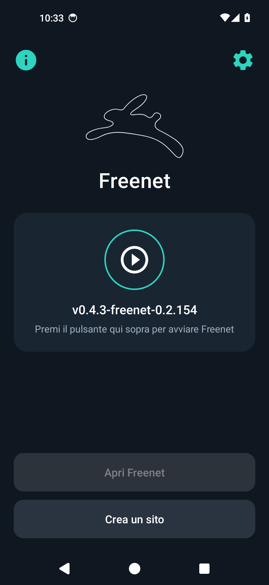
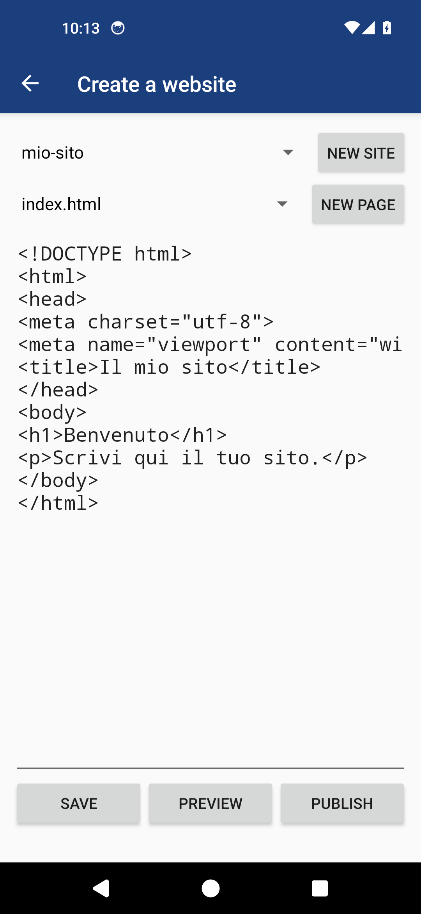

# Freenet mobile (non ufficiale)

App Android che fa girare sul telefono la nuova [Freenet](https://freenet.org) e apre le sue
app, come River. Nasce da [freenet-mobile/app](https://github.com/freenet-mobile/app), che usava
la vecchia rete (oggi Hyphanet). Non è un'app di The Freenet Project.

 

## Cosa cambia rispetto all'originale

- Il motore `fred` è sostituito dal programma ufficiale `freenet` (vedi `prepara-freenet.sh`).
- Telemetria e aggiornamento automatico sono spenti.
- L'accesso da PC senza password è stato tolto.
- Niente permessi per l'archivio, niente backup dei dati, niente immagini esterne.

- C'è un editor HTML: scrivi le pagine, guardi l'anteprima e pubblichi con `fdev website`.

- Ha uno stile scuro nuovo.
- Può cercare e scaricare da sola le nuove versioni da GitHub. L'installazione la confermi sempre tu.

## Compilare

Servono JDK 21 e Android SDK (piattaforma 35, build-tools 35.0.0).

    ./prepara-freenet.sh
    ./gradlew assembleRelease

L'APK per telefoni finisce in `app/build/outputs/apk/release/`. I programmi `freenet` e `fdev`
non sono nel repository: li scarica `prepara-freenet.sh`, che ne controlla le impronte.

## Limiti noti

- Non è un'app ufficiale di The Freenet Project. La 1.0 non è stata verificata fino in fondo su un telefono vero: avvio del nodo, chat River e pubblicazione dei siti possono ancora dare problemi.
- Gli aggiornamenti funzionano solo con APK firmati dalla stessa chiave, che resta fuori dal repository. Senza quella chiave la build usa la chiave di debug.
- La chat River è stata segnalata come non funzionante. Dalla 0.4.1 c'è una correzione, ma non è stata verificata.
- Sull'emulatore x86_64 il nodo non parte: Android blocca la chiamata di sistema `poll`.
- Le altre app sullo stesso telefono possono raggiungere il nodo su `127.0.0.1:7509`.
- La versione di Freenet è fissa: per aggiornarla va cambiata in `prepara-freenet.sh` e
  `app/build.gradle`.

## Licenza

GPL v3 (`LICENSE`). Autori originali, Freenet (AGPL) e altri componenti sono in `NOTICE.md`.
